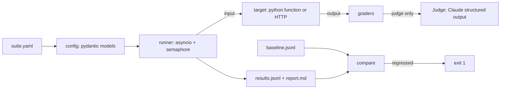

# llm-eval-harness

Regression testing for LLM apps: YAML suites, deterministic + LLM-as-judge graders, CI gate.

[](https://github.com/Muhaman/llm-eval-harness/actions/workflows/ci.yml)

## What it does

Describe test cases for an LLM-backed function or HTTP endpoint in a YAML suite. `evalh run` calls the target for every case with bounded concurrency, grades each output with one or more graders, writes per-case JSONL results plus a Markdown report, and compares against a saved baseline. It exits non-zero when quality regresses, so it can gate a pull request.

Graders:

| Type | Passes when |
|---|---|
| `exact` | output equals `expected` after trimming whitespace |
| `regex` | `pattern` matches anywhere in the output |
| `contains` | every string in `all` appears in the output |
| `json_schema` | output is JSON and validates against `schema` (JSON Schema 2020-12) |
| `judge` | a Claude judge scores the output against `rubric` at or above `pass_threshold` (default 0.7) |

A case passes only if all of its graders pass.

## Architecture



## Quickstart

```bash
uv sync --all-extras --dev
export ANTHROPIC_API_KEY=...   # only needed for suites with judge graders
uv run evalh run examples/suite.yaml
```

The example suite tests a fictional, deterministic "Acme Notes" support bot (`examples/target.py`). All data in the repo is synthetic.

## Usage

```bash
evalh run SUITE [--out results.jsonl] [--report report.md] \
  [--baseline PATH] [--threshold 0.02] [--concurrency 8] [--timeout 60]
```

Exit codes: `0` success (failing cases without a baseline still exit 0; the report lists them), `1` regression vs baseline, `2` configuration error (bad suite, missing file, missing `ANTHROPIC_API_KEY` for judge suites).

Targets:

```yaml
target: {type: python, ref: "mypkg.app:answer"}   # fn(input) -> str, sync or async
target: {type: http, ref: "https://host/ask"}     # POST {"input": ...}; reads {"output": "..."} or body text
```

Python targets are imported with the suite's directory on `sys.path`.

Regression gate: keep the last accepted `results.jsonl` as `baseline.jsonl`. A run regresses when the pass rate drops by more than `--threshold` or any case that passed in the baseline now fails. See `examples/eval-gate.yml` for a GitHub Actions workflow.

Docker:

```bash
docker build -t evalh .
docker run --rm -e ANTHROPIC_API_KEY evalh run examples/suite.yaml
```

The judge grader needs `ANTHROPIC_API_KEY`, hence the `-e` flag above. It uses `EVALH_JUDGE_MODEL` (default `claude-haiku-5-5`) at `low` effort and returns a pydantic-validated `{score, reasoning}`.

## Design decisions & trade-offs

- **Case-level pass/fail, not just a mean score.** Averages hide a single broken behavior; the gate fails on any newly failing case as well as on pass-rate drops.
- **Judge via structured outputs.** `messages.parse` with a pydantic model removes free-text score parsing. A refusal or `max_tokens` stop surfaces as an error on that case instead of a silent zero. Haiku 5.5 has no server-side refusal fallback, so none is configured.
- **Judge input is wrapped in XML tags** and the system prompt marks it as data, which reduces (does not eliminate) prompt injection from the output under test.
- **Per-case errors never abort the run.** Timeouts, target exceptions and grader failures are recorded on the case so one bad case cannot hide the rest.
- **JSONL results.** Append-friendly, diffable, trivially stored as a CI artifact or committed baseline.
- **Sync targets run in a thread.** The timeout stops waiting but cannot kill the thread; prefer async targets for long calls.

## Testing

```bash
uv run pytest -q
uv run ruff check . && uv run ruff format --check . && uv run mypy src
```

Tests cover each grader (judge uses a fake, no network), timeout and concurrency behavior of the runner, baseline comparison, config validation and CLI exit codes. CI runs lint, format, `mypy --strict` and the tests on every push.

## Limitations & next steps

- No retries or result caching; every run re-calls the target and judge.
- Single judge sample per case; no multi-judge agreement or calibration against human labels.
- Baseline is a flat file; no history or trend view.
- HTTP target supports only a JSON POST contract.

## License

MIT
